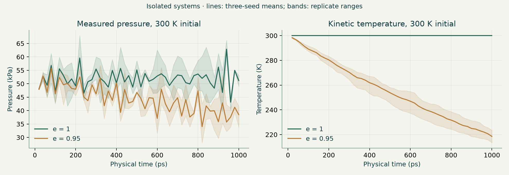
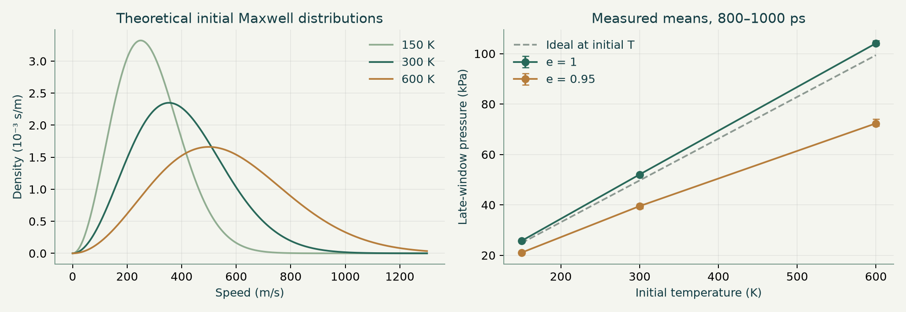

# From molecular speeds to macroscopic pressure
## Maxwell distributions and elastic versus dissipative collisions

**Simulation study · 7 October 2026**

## Executive summary

The measured elastic-gas pressure increased approximately in direct proportion to absolute temperature: the three-seed mean pressures over complete 1000 ps runs were **25.9, 51.9 and 103.8 kPa** at 150, 300 and 600 K. Molecules were not given one common speed; initial velocities were sampled to produce a three-dimensional Maxwell speed distribution.

Slightly inelastic particle collisions changed the energy balance. With restitution coefficient **e = 0.95** and no thermostat, the initially 300 K gas ended at **219 K** on average. Its pressure fell from **49.8 kPa in early windows to 39.5 kPa in late windows**, a 20.6% decline. Holding temperature at 300 K removed that pressure drift, but required external energy. This tests the elastic-collision approximation; it does **not** establish that ordinary real molecular gases continually lose total energy on collision.

## Key findings

- **Temperature changes a distribution, not a single speed.** Mean initial sampled speeds were approximately 282, 399 and 564 m/s. They follow the expected √T scaling.
- **Pressure has two microscopic contributors.** Heating increases both momentum transferred per wall impact and wall-impact frequency; multiplying their √T dependencies gives P ∝ T at fixed density.
- **Stability means no systematic drift, not a flat trace.** Elastic pressure fluctuated because only 96 particles were simulated. Inelastic pressure declined as translational energy was removed.
- **A thermostat changes the experiment.** Stable pressure with dissipative collisions was sustained by energy supply, not by spontaneous energy conservation.
- **The real-gas comparison is conceptual.** Attractions and excluded volume—not a universal collision-energy leak—produce ordinary real-gas departures from the ideal equation of state.[^1][^2][^5]

## 1. Goals and complete AI prompt

The two investigation goals were to connect the Maxwell speed distribution to observable pressure, and to isolate what happens when collisions cease to conserve translational kinetic energy. Required visual outputs were paired molecular animations, speed-distribution plots, and real-time wall-impulse pressure data.

The full, reusable prompt is delivered separately as **simulation-prompt.md** and is available inside the app under **Complete AI prompt**. It defines the physical equations, initialization, units, collision rules, visualization, controls, experiment matrix, verification checks and report requirements. Its central instruction is: *use one deterministic physics engine for the visual simulation and recorded runs; measure pressure from accumulated wall momentum transfer rather than assigning it from the ideal-gas equation.*

The simulation is a genuine 3D dynamical model rendered as a 2D perspective projection. The ivory/deep-teal interface follows the supplied image's visual direction without copying its content.

## 2. Method and parameter runs

### Model specification

| Parameter | Value or rule |
|---|---|
| Particle count | N = 96 equal-mass, nonrotating spheres |
| Particle mass | m = 6.6335209 × 10⁻²⁶ kg; argon-mass surrogate |
| Cube side / geometric volume | L = 20 nm; V = 8.00 × 10⁻²⁴ m³ |
| Surrogate sphere radius | r = 0.35 nm; not a fitted argon collision potential |
| Initial temperatures | 150, 300 and 600 K |
| Particle restitution | e = 1 or 0.95 |
| Wall restitution | 1 in every run |
| Default integration step | 0.05 ps |
| Pressure averaging interval | Consecutive nonoverlapping 20 ps windows |
| Duration | 1000 ps per recorded run |
| Main replicate seeds | 42, 137, 271 |
| Thermostat | Off by default; optional global velocity rescaling each step |

Uniform initial positions were rejection-sampled to avoid overlap. Three independent Gaussian velocity components were sampled, each with variance k_B T/m. Initial bulk drift was removed and all velocities uniformly rescaled to the target kinetic temperature. This preserves a Maxwell-like spread but conditions the finite ensemble: the final initial velocities are no longer perfectly independent canonical samples. Both collision cases used identical initial positions and velocities for each seed.

The solver advances ballistic motion in fixed timesteps, reflects particles at fixed walls, and resolves contacting hard-sphere pairs by a normal impulse. It corrects geometric overlaps and applies a collision impulse only to approaching pairs. Tangential relative velocity is unchanged. A thermostat, when enabled, restores the target kinetic energy each timestep and records the energy supplied. This artificial feedback does not guarantee canonical equilibrium sampling.

**Experiment matrix:** 18 isolated runs (3 temperatures × 2 restitution values × 3 seeds), 6 thermostatted runs (300 K × 2 restitution values × 3 seeds), and 4 timestep-sensitivity runs (300 K, seed 42, 2 restitution values, dt = 0.025 or 0.1 ps). In total, **28 runs produced 1400 completed measurement windows**. These are computed numerical observations from the same engine as the app, not physical laboratory measurements or fabricated animation impressions.

### Measurement definitions

Kinetic temperature is T_kin = 2E_kin/(3Nk_B), using velocities in the stationary-box frame. For this small, confined system it is best understood as an operational translational-energy temperature; bulk motion is removed initially, not dynamically subtracted afterward.

For each elastic wall impact, normal momentum transfer is Δp = 2m|v_n|. Pressure is measured independently as:

**P_wall = ΣΔp_wall / (6L² Δt).**

All six walls contribute. Pressure is reported in kPa, time in ps, speeds in m/s, mean impulse in N·s, and energy in joules. The separately recorded benchmark is P_ideal = Nk_B T_kin/L³. Early pressure means use windows ending at 20–200 ps (10 windows); late means use windows ending at 800–1000 ps (11 windows). The first interval includes the initial redistribution transient and is not a claim of equilibrated sampling.

## 3. Recorded observations

### Isolated gases: temperature and pressure

Values below are means across three seeds. Bracketed late-pressure values show the **replicate minimum–maximum**, not a confidence interval.

| Initial T (K) | e | Initial mean speed (m/s) | Final T (K) | Early P (kPa) | Late P (kPa), replicate range | Early→late change |
|---:|---:|---:|---:|---:|---:|---:|
| 150 | 1.00 | 282 | 150 | 26.1 | 25.7 [25.2–26.0] | −1.7% |
| 150 | 0.95 | 282 | 121 | 24.9 | 21.0 [20.8–21.3] | −15.6% |
| 300 | 1.00 | 399 | 300 | 51.4 | 52.1 [51.8–52.3] | +1.4% |
| 300 | 0.95 | 399 | 219 | 49.8 | 39.5 [38.5–40.5] | −20.6% |
| 600 | 1.00 | 564 | 600 | 103.2 | 104.1 [103.4–105.2] | +0.9% |
| 600 | 0.95 | 564 | 397 | 99.2 | 72.3 [71.3–74.1] | −27.1% |

The elastic gas's temperature remained constant to numerical roundoff. Its early-to-late pressure differences were small relative to the dissipative decline and changed sign between conditions; there is no consistent elastic cooling trend. Final inelastic temperatures spanned 119–122 K, 213–224 K and 389–408 K across seeds.

Inelastic fractional cooling was greater at higher initial temperature during the same physical observation time. Hotter particles had more collision opportunities: mean total elastic pair-collision counts over 1000 ps were approximately **366, 556 and 768** for 150, 300 and 600 K. This supports the interpretation that faster collisions accelerate energy removal; it is not a new equilibrium pressure law.

### What changed at the walls?

At initial 300 K, the isolated e = 0.95 runs had:

| Observable | Early windows | Late windows | Change |
|---|---:|---:|---:|
| Total wall-hit frequency | 2.95 ps⁻¹ | 2.64 ps⁻¹ | About −10% |
| Mean wall impulse | 4.06 × 10⁻²³ N·s | 3.60 × 10⁻²³ N·s | About −12% |
| Measured pressure | 49.8 kPa | 39.5 kPa | About −21% |

Both microscopic mechanisms moved in the same direction. Their approximate product is consistent with the observed pressure decline. Multiplying independently averaged impulse and hit rate is not exactly equivalent to averaging their window-by-window product, because those quantities can be correlated.

Across elastic initial conditions, early wall rates increased from 2.14 to 2.99 to 4.18 ps⁻¹, and mean impulses increased from 2.94 to 4.14 to 5.93 × 10⁻²³ N·s. Each roughly follows √T. Whole-run elastic pressure ratios were about **1 : 2.003 : 4.006**, consistent with linear scaling.

### Thermostatted comparison at 300 K

| e | Early P (kPa) | Late P (kPa) | Final T (K) | Mean supplied energy over 1000 ps |
|---:|---:|---:|---:|---:|
| 1.00 | 51.4 | 52.1 | 300 | Approximately zero; roundoff only |
| 0.95 | 51.9 | 51.7 | 300 | 2.05 × 10⁻¹⁹ J |

The initially stored energy was 5.96 × 10⁻¹⁹ J. Maintaining temperature in the inelastic system supplied roughly **34% of this initial energy** over the run. Thus, its stable pressure does not contradict dissipation: the thermostat continuously replenished the energy loss.

Pressure stability and fluctuation amplitude must be distinguished. Mean per-run coefficients of variation of the 20 ps pressure samples were 14.5%, 10.3%, and 7.2% for isolated elastic 150/300/600 K, versus 14.4%, 13.9%, and 13.8% for inelastic cases. At 150 K the inelastic trace was not noisier by this metric, despite its systematic decline. The statistic includes drift and should not be interpreted as pure equilibrium noise. Thermostatted 300 K coefficients were 8.9% and 9.6% for elastic and inelastic cases, respectively.

## 4. Physical mechanisms

### Maxwell speeds: why heating shifts and broadens the curve

For a classical, equilibrium translational gas, each velocity component is Gaussian while the speed—the magnitude of three components—has the Maxwell distribution. Its v² factor makes probability density vanish at v = 0; its exponential suppresses the high-speed tail. Heating spreads the distribution over a wider speed range and shifts the maximum rightward.[^3][^4][^6]

The characteristic speeds are:

- Most probable: v_mp = √(2k_B T/m)
- Mean: ⟨v⟩ = √(8k_B T/(πm))
- RMS: v_rms = √(3k_B T/m)

They differ, but all scale as √T. At 300 K for the specified mass, they are approximately **353, 399 and 433 m/s**. Doubling temperature multiplies these speeds by √2, while quadrupling temperature doubles them. Heating does not simply make every molecule move at the new mean.

The live dashed curve is the **initial-temperature theoretical Maxwell reference**. It is deliberately not redefined as a measured curve when the dissipative sample cools. A small evolving histogram can be uneven; that alone does not establish a non-Maxwell tail. No claim of a statistically resolved tail departure is made here.

### From individual impacts to the ideal-gas equation

An elastic impact against a fixed wall changes a molecule's normal momentum by 2m|v_n|. Faster motion also reduces the time between impacts. For isotropic velocities, ⟨v_n²⟩ = ⟨v²⟩/3, leading in the point-particle/dilute limit to:

**P = (N/V)m⟨v²⟩/3 = (N/V)k_B T.**

This depends on the mean-square speed, not on the square of the mean speed. At fixed geometry, momentum per impact and impact rate each scale approximately as √T, so pressure scales as T.[^3][^4][^6] The simulation independently sums wall impulses, making this a testable connection rather than a pressure value inserted by assumption.

### Why slight inelasticity causes cooling

For equal masses, pair center-of-mass momentum is conserved, but normal relative kinetic energy is multiplied by e². The removed energy is:

**ΔE_loss = m(1−e²)g_n²/4.**

At e = 0.95, 1−e² = 0.0975: 9.75% of the **relative normal** kinetic energy is lost at an approaching contact. The center-of-mass energy and tangential relative energy are unaffected. It would be incorrect to say each collision destroys 9.75% of all particle energy.

Repeated losses reduce kinetic temperature and speeds. Wall-hit rates and impulses therefore decline. As cooling progresses, collision rates also decrease, slowing further cooling. This feedback is qualitatively consistent with homogeneous granular-cooling theory; Haff's law has the form T(t) ∝ [1+t/τ]⁻² under appropriate assumptions.[^7][^8][^9] This study did **not** fit or validate that law and should not claim to have measured its exponent.

## 5. Ideal versus real gas behavior

The elastic case approximates a dilute ideal gas: no attractions, simple ballistic motion, conserved translational energy, and small occupied particle volume. Elasticity alone is not sufficient for exact ideal behavior, because finite particle size remains in the simulation.

For ordinary real gases, molecular attractions can reduce pressure relative to the ideal benchmark at the same T and density, while finite molecular volume and repulsion can raise it as crowding becomes important. A qualitative correction is the van der Waals expression:

**[P + a(n_mol/V)²](V − n_mol b) = n_mol R T.**

Here a describes attractions and b describes excluded volume; n_mol is amount in moles, not number density. These effects explain why ideal behavior is generally best at low density and sufficiently high temperature.[^1][^2][^5] They are **not implemented** as a real-gas equation of state in this app.

Real molecular encounters can exchange translational, rotational, vibrational and potential energies. Lower translational energy in one encounter does not imply destruction of total energy. Our dissipative model removes energy from the tracked translational system into an unspecified sink. It is therefore a useful granular-gas analogue or deliberate test of a model assumption, not a realistic prediction that sealed ordinary gas continuously cools at every collision.

## 6. Verification, uncertainties and limitations

1. **Energy accounting passed.** Across all 28 runs, the largest relative residual in E_final + E_lost − E_added − E_initial was about **4.4 × 10⁻¹⁵**. Elastic temperature remained constant to roundoff. This verifies accounting, not exact trajectory accuracy.
2. **Maxwell moment check passed.** Across 200 independent initial seeds (19,200 sampled speeds at 300 K), observed mean speed was **399.28 m/s**, compared with **398.75 m/s** theoretically: a 0.13% difference. This checks one moment, not every feature of the distribution.
3. **Timestep sensitivity is visible.** At 300 K, seed 42, inelastic final temperatures were 223.0, 218.6 and 225.6 K for dt = 0.025, 0.05 and 0.1 ps. Late pressures were 39.97, 39.52 and 40.74 kPa. Halving the default step changed final T by about 2% and late pressure by about 1%; doubling it changed them by about 3%. Differences are not monotonic because collision sequences diverge. Elastic late pressures were 51.99, 52.32 and 51.69 kPa. These checks support the qualitative result, not a converged high-precision prediction.
4. **Finite size shifts the benchmark.** Ideal initial pressures are 24.85, 49.70 and 99.41 kPa, whereas whole-run elastic measured means were about 4.3–4.4% higher. The physical wall faces use L, but sphere centers travel over L−2r = 19.3 nm. Even without pair collisions this changes the wall-force geometry by a factor L/(L−2r) ≈ 1.036. Occupied sphere volume is about 0.22% of box volume. Wall exclusion, pair interactions, finite sampling and solver effects all matter; the excess cannot be assigned solely to a real-argon compressibility correction.
5. **Finite N causes substantial noise.** Three seeds establish repeatability of the trend, not a narrow statistical confidence interval. Twenty-picosecond windows can contain only a few dozen wall hits. Within-run windows are not necessarily independent.
6. **Collision detection is approximate.** The fixed-step overlap solver is not event-driven; contact order, overlap correction and boundary interactions introduce error. The chosen timestep makes typical displacements small relative to the diameter, but does not formally eliminate missed or shifted contacts.
7. **No attractions, internal modes or phase transitions.** No condensation, chemistry, radiation or quantum effects are modeled. A thermostat changes velocities by artificial global rescaling; it does not recreate a physical heat bath in detail.
8. **Visual output is a projection.** Apparent 2D crossings do not necessarily represent 3D contacts. Trails show projected velocity. Animation pacing is slowed and not a literal nanosecond-speed recording.

## 7. Conclusion and reproduction

The simulations support the kinetic-theory mechanism: raising temperature increases a broad spread of speeds, increasing both impulse and impact frequency, so pressure increases approximately linearly at fixed density. Elastic collisions maintain energy and a stable pressure mean; dissipative collisions cause isolated translational cooling and pressure drift. A thermostat can maintain that mean by supplying measurable energy.

The strongest lesson is about **energy balance and the boundaries of a model**, not that “real gases are inelastic ideal gases.” Real-gas behavior needs attractions, molecular size and a full energy accounting beyond this teaching comparison.

To reproduce, unzip the delivered **reproducibility-kit.zip**, use Bun, and run `bun run run-experiments.ts` from its root. The kit includes the exact shared physics engine and runner; results go to a local `data/` folder. The web app exposes the prompt, report and measurements. The separately delivered CSV contains all windows, and `summary.csv` plus `checks.json` contain per-run summaries and verification outputs. Dataset metadata fields are `kind`, `initialTemperature` (K), `restitution`, `seed`, `thermostat`, and `dt` (ps). Sample fields use `time` (ps), `temperature` (K), `pressure`/`idealPressure` (kPa), `meanSpeed`/`rmsSpeed` (m/s), `wallRate`/`pairRate` (events/ps), `impulse` (N·s), and energy fields (J).

## References

Textbook and university teaching sources ground kinetic theory; peer-reviewed research grounds the granular analogy. Core equations are corroborated across independent teaching sources; measured numbers come exclusively from this study's saved runs. All links accessed 7 October 2026.

[^1]: OpenStax. *Chemistry 2e*, §9.6, “Non-Ideal Gas Behavior.” https://openstax.org/books/chemistry-2e/pages/9-6-non-ideal-gas-behavior
[^2]: OpenStax. *University Physics Volume 2*, §2.1, “Molecular Model of an Ideal Gas,” including van der Waals corrections. https://openstax.org/books/university-physics-volume-2/pages/2-1-molecular-model-of-an-ideal-gas
[^3]: OpenStax. *College Physics 2e*, §13.4, “Kinetic Theory: Atomic and Molecular Explanation of Pressure and Temperature.” https://openstax.org/books/college-physics-2e/pages/13-4-kinetic-theory-atomic-and-molecular-explanation-of-pressure-and-temperature
[^4]: Pennsylvania State University, V. F. M. teaching materials. “Lecture 3: Kinetic theory of gas, including Maxwell–Boltzmann.” https://sites.esm.psu.edu/~vfm5153/TSM/lecture3.html
[^5]: Khan Academy. “Real gases: Deviations from ideal behavior.” Used for corroboration of the conceptual real-gas comparison; search-visible summary, full page retrieval unavailable. https://www.khanacademy.org/science/ap-chemistry-beta/x2eef969c74e0d802:intermolecular-forces-and-properties/x2eef969c74e0d802:deviation-from-ideal-gas-law/v/real-gases-deviations-from-ideal-behavior
[^6]: C. R. Nave, Georgia State University. HyperPhysics, “Kinetic Temperature, Thermal Energy.” https://hyperphysics.phy-astr.gsu.edu/hbase/Kinetic/kintem.html
[^7]: D. Puzyrev, T. Trittel, K. Harth and R. Stannarius. “Cooling of a granular gas mixture in microgravity.” *npj Microgravity* 10, 36 (2024). https://doi.org/10.1038/s41526-024-00369-5 ; full text: https://pmc.ncbi.nlm.nih.gov/articles/PMC10959983/
[^8]: P. K. Haff. “Grain flow as a fluid-mechanical phenomenon.” *Journal of Fluid Mechanics* 134, 401–430 (1983). https://doi.org/10.1017/S0022112083003419 . Original cooling theory, identified through the references and discussion in [^7].
[^9]: P. Yu et al. “Velocity Distribution of a Homogeneously Cooling Granular Gas.” *Physical Review Letters* 124, 208007 (2020). Search-indexed paper corroborates cooling and distribution context; no new fitted claims rely on it here. https://elib.dlr.de/135102/1/PhysRevLett.124.208007.pdf